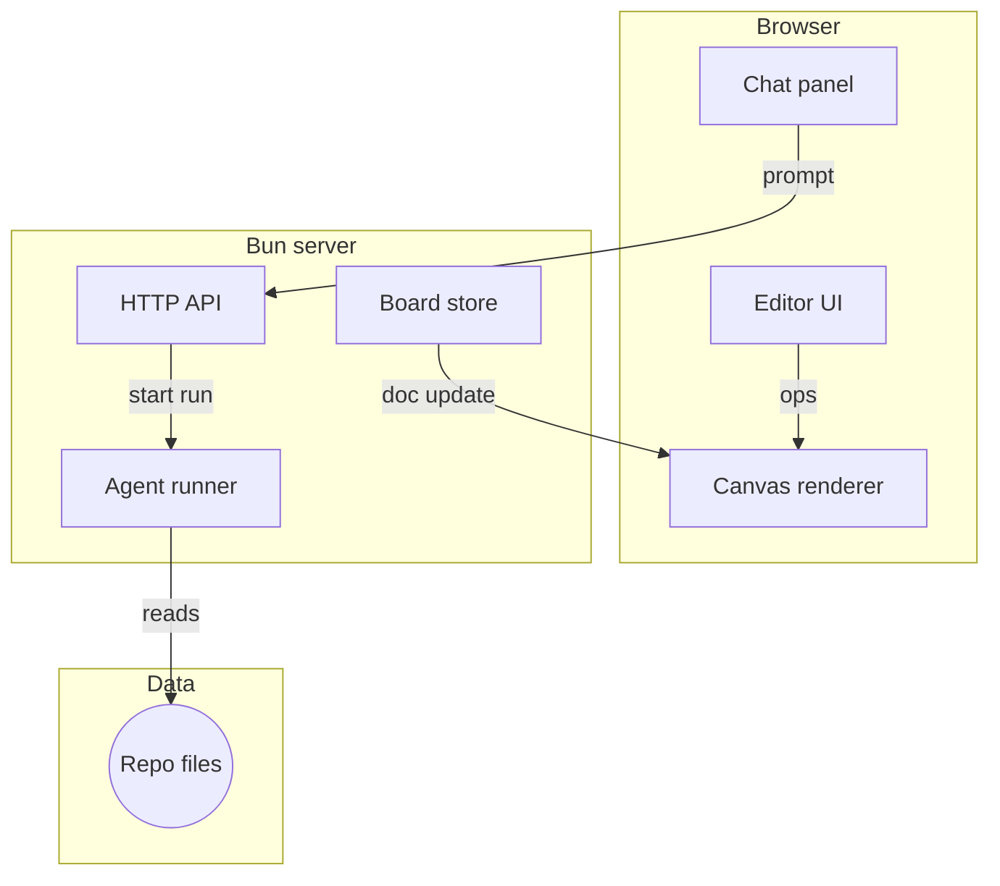

# Architecture

Use for: system maps, deployment layouts, "how does X talk to Y".

Structure:
- Root `flowchart TB`. One `subgraph` per boundary (client, server, data, third party),
  each with `direction LR`.
- Nodes are components. Edges are calls or data flow, labelled with a verb.
- Datastores as `((name))` (ellipse). External systems in their own subgraph.

Example:

Common mistakes:
- One node per file or class. Draw components, not code.
- Edges without labels between groups. Say what flows.
- A component the code does not have. Read the repo first; mark gaps `?`.
