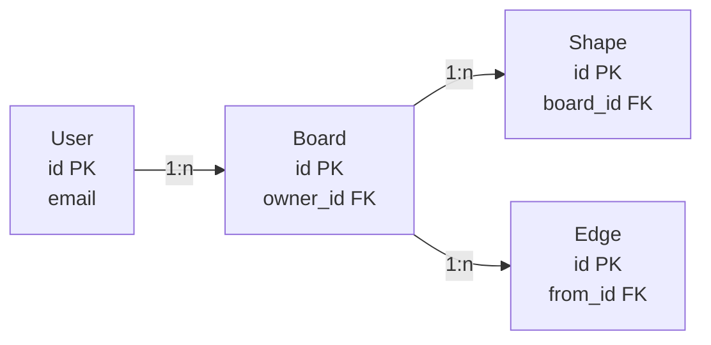

# ER (entities and relations)

Use for: data models, tables and keys.

Structure:
- One node per entity. Text = entity name, then key fields on new lines (≤ 4 lines).
- Edges = relations, labelled with cardinality: `1:n`, `n:1`, `1:1`, `n:m`.
  Point the edge from the "one" side to the "many" side.
- `flowchart LR`. Group only by bounded context (billing, core).

Example:

Common mistakes:
- Every column listed. Show keys and 1 or 2 key fields only.
- Relations without cardinality.
- Inventing columns. Read the schema or migrations first; mark unknown fields `?`.
