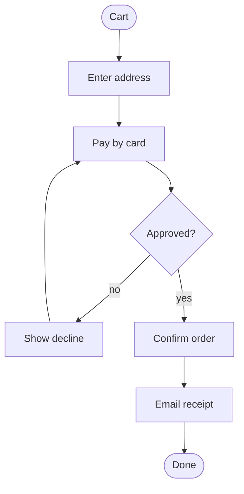

# Flow

Use for: processes, user journeys, decision logic, release steps.

Structure:
- `flowchart TB` for long flows, `LR` for short ones (6 steps or fewer).
- Steps as `[rect]`, decisions as `{diamond}` with labelled exits (`yes` / `no`).
- Start and end as `([stadium])`. One start node.
- Loops (retry) go back with a labelled edge.
- Lanes per actor only when the actor changes: one `subgraph` per actor.

Example:

Common mistakes:
- A decision with an unlabelled exit.
- Sentences as steps. Use verb + noun, 2 to 4 words.
- Several start nodes. Merge them into one.
