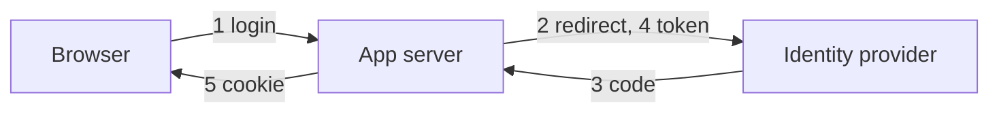

# Sequence

Use for: request/response order between parties (login, payment, one chat turn).

The board has no lifelines. Draw a sequence as numbered messages:
- One `subgraph` per participant is NOT used. Participants are nodes in a row:
  `flowchart LR`, one node per participant, `role: "actor"` or `"service"`.
- Each message is an edge labelled `1 name`, `2 name`, … in time order.
- A reply is a separate edge back, with its own number. `draw_mermaid` routes it as an
  elbow so it does not sit on the first edge.
- Two messages in the same direction between the same pair: one edge, joined label
  (`2 redirect, 4 token`). Parallel edges overlap.
- More than 8 messages: split into two diagrams (setup, main path).

Example:

Common mistakes:
- Unnumbered edges: the order is lost.
- Long labels. Keep "N verb noun", 3 words at most.
- Two edges with the same direction and number.
